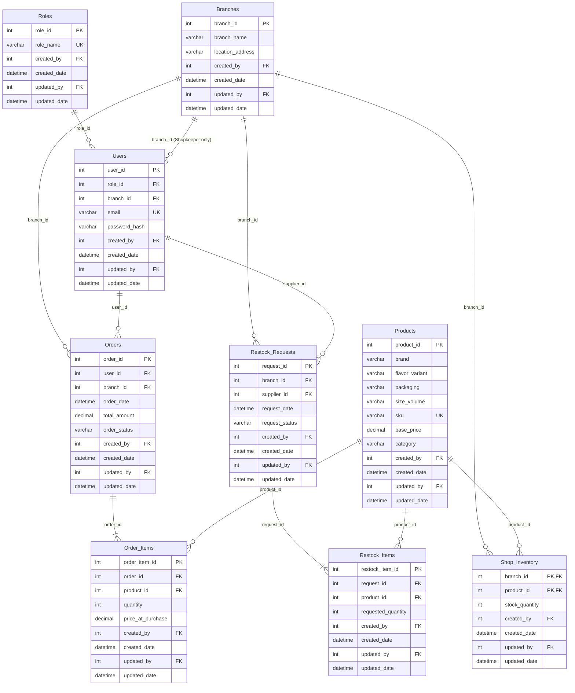

# FizzDrop Database Tier Implementation

This directory contains the authoritative MySQL 8.0+ relational schema, stored procedures, audit logging, secondary index definitions, seed data, and verification tests for the **FizzDrop Multi-Tier Beverage E-Commerce & B2B Logistics Platform**.

---

## 1. Architectural Intent & Decisions

1. **Strict Separation of Global Catalog & Physical Inventory**:
   - Master product attributes (`brand`, `flavor_variant`, `packaging`, `size_volume`, `sku`, `base_price`, `category`) are normalized in the `Products` table.
   - Retail branches maintain local stock counts in `Shop_Inventory` (keyed by composite primary key `(branch_id, product_id)`), isolating store stock and preventing overselling.
2. **Role-Based Location Association**:
   - Roles: `Customer`, `Shopkeeper`, and `Supplier`.
   - `Users.branch_id` is nullable:
     - **Shopkeepers**: Must be linked to their designated physical branch (`branch_id IS NOT NULL`).
     - **Customers & Central Suppliers**: Not bound to a branch (`branch_id IS NULL`).
     - Enforced at the engine level via database triggers (`trg_users_role_branch_insert` & `trg_users_role_branch_update`).
3. **Historical Price Immutability**:
   - `Order_Items` explicitly records `price_at_purchase` alongside `quantity`. Any future update to `Products.base_price` leaves historical invoices and accounting records intact.
4. **Universal Audit Logging**:
   - Every single table in the schema implements 4 universal audit columns:
     - `created_by` (`INT NULL`, FK to `Users.user_id`)
     - `created_date` (`DATETIME NOT NULL DEFAULT CURRENT_TIMESTAMP`)
     - `updated_by` (`INT NULL`, FK to `Users.user_id`)
     - `updated_date` (`DATETIME NOT NULL DEFAULT CURRENT_TIMESTAMP ON UPDATE CURRENT_TIMESTAMP`)
5. **Referential Deletion Restraints**:
   - Deletions on `Products` and `Users` are strictly set to `ON DELETE RESTRICT` to preserve transaction history and order receipts.

---

## 2. Entity Relationship Diagram (ERD)



---

## 3. Dependency Resolution & Execution Sequence

Because audit foreign keys create circular dependencies across `Users`, `Roles`, and `Branches`, migrations execute in the following exact order:

1. **Base Lookups without Audit Foreign Keys**: Create `Roles` and `Branches` with `created_by` and `updated_by` defined without foreign key constraints.
2. **Central Identity Table**: Create `Users` with FKs to `Roles(role_id)`, `Branches(branch_id)`, and self-referencing FKs for audit logging.
3. **Patch Base Lookups**: Execute `ALTER TABLE Roles` and `ALTER TABLE Branches` to attach foreign key constraints on `created_by` and `updated_by` pointing to `Users(user_id)`.
4. **Master Catalog & Inventory**: Create `Products` and `Shop_Inventory` (with composite PK `(branch_id, product_id)`).
5. **Transaction & Logistics Headers**: Create parent tables `Orders` and `Restock_Requests`.
6. **Transaction & Logistics Line Items**: Create dependent tables `Order_Items` and `Restock_Items`.
7. **Secondary Indexes & Triggers**: Apply mandated performance indexes and role-branch integrity triggers.
8. **Stored Procedures**: Deploy atomic transactional routines.
9. **Seed Data**: Ingest initial Roles, Branches, Users, Master Products, Branch Inventory, Sample Orders, and Restock Requests.

---

## 4. Mandated Secondary Indexes & Optimization

The following secondary indexes are deployed to ensure optimal query performance:

| Index Name | Table | Columns | Purpose |
| :--- | :--- | :--- | :--- |
| `idx_users_branch_role` | `Users` | `(branch_id, role_id)` | Fast auth permission checks and branch scoping on login |
| `idx_products_brand_cat_size` | `Products` | `(brand, category, size_volume)` | Catalog filtering and mobile menu browsing |
| `uq_products_sku` | `Products` | `(sku)` | O(1) single-read SKU bar-code and inventory lookups |
| `idx_shop_inventory_branch_stock`| `Shop_Inventory` | `(branch_id, stock_quantity)`| Fast scanning of low-stock thresholds for shopkeeper restock prompts |
| `idx_orders_branch_status_date` | `Orders` | `(branch_id, order_status, order_date)` | Real-time order dispatch queue polling by branch managers |
| `idx_orders_user_date` | `Orders` | `(user_id, order_date)` | Customer order history pagination |
| `idx_restock_branch_status_date`| `Restock_Requests` | `(branch_id, request_status, request_date)` | Branch restock queue status lookups |
| `idx_restock_supplier_status` | `Restock_Requests` | `(supplier_id, request_status)` | Supplier fulfillment dispatch queues |

---

## 5. Transactional Integrity & Business Rules

### A. Atomic Stock Deduction (Anti-Overselling)
When an order is placed, concurrency is handled with row-level locks to prevent race conditions:

```sql
START TRANSACTION;

-- 1. Row-level lock on the branch's specific inventory row
SELECT stock_quantity 
FROM Shop_Inventory 
WHERE branch_id = :branchId AND product_id = :productId 
FOR UPDATE;

-- 2. Guard: if stock_quantity < requested_quantity => ROLLBACK;

-- 3. Atomic stock decrement
UPDATE Shop_Inventory 
SET stock_quantity = stock_quantity - :qty, 
    updated_by = :userId, 
    updated_date = NOW()
WHERE branch_id = :branchId AND product_id = :productId;

-- 4. Insert Orders and Order_Items records
-- 5. COMMIT;
```

A production-ready stored procedure `sp_PlaceCustomerOrder` encapsulates this entire flow and can be invoked with a JSON line-items payload:
```sql
CALL sp_PlaceCustomerOrder(
    6,                      -- Customer user_id
    1,                      -- Branch branch_id
    '[{"product_id": 1, "quantity": 2}, {"product_id": 2, "quantity": 1}]',
    @order_id,
    @total_amount
);
SELECT @order_id, @total_amount;
```

### B. B2B Replenishment Fulfillment
When a Supplier approves a Restock Request (`request_status` -> `'Approved'`), `sp_ApproveRestockRequest` executes an atomic transaction that:
1. Validates the request is in `'Pending'` status.
2. Iterates associated `Restock_Items`.
3. Atomically increments `Shop_Inventory.stock_quantity` for the requesting branch.
4. Marks the request as `'Approved'` and records the approving `supplier_id` and audit metadata.

```sql
CALL sp_ApproveRestockRequest(
    2, -- request_id
    1  -- supplier_id
);
```

---

## 6. Directory Structure

```
database/
├── schema/
│   └── 01_fizzdrop_schema.sql         # Core DDL, FK constraints, triggers, indexes
├── procedures/
│   └── 02_fizzdrop_procedures.sql     # sp_PlaceCustomerOrder, sp_ApproveRestockRequest, sp_GetLowStockProducts
├── seeds/
│   └── 03_fizzdrop_seed_data.sql      # Seed roles, branches, users, products, inventories, orders
├── tests/
│   └── 04_test_suite.sql              # Automated verification test suite
├── deploy.sql                         # All-in-one consolidated deployment script
├── reset_db.sql                       # Database drop/clean recreation script
└── README.md                          # Comprehensive documentation and integration guide
```

---

## 7. Deployment Instructions

### Option A: Using Single Consolidated Script (Recommended)
```bash
mysql -u <username> -p < database/deploy.sql
```

### Option B: Using Step-by-Step Modular Scripts
```bash
# 1. Reset database
mysql -u <username> -p < database/reset_db.sql

# 2. Deploy Schema, FKs, Indexes & Triggers
mysql -u <username> -p < database/schema/01_fizzdrop_schema.sql

# 3. Deploy Stored Procedures
mysql -u <username> -p < database/procedures/02_fizzdrop_procedures.sql

# 4. Provision Seed Data
mysql -u <username> -p < database/seeds/03_fizzdrop_seed_data.sql

# 5. Run Verification Test Suite
mysql -u <username> -p < database/tests/04_test_suite.sql
```

---

## 8. Backend Integration Notes (For ASP.NET Core)

When constructing the ASP.NET Core backend:
1. **Connection String**:
   ```json
   "ConnectionStrings": {
     "FizzDropConnection": "Server=localhost;Port=3306;Database=fizzdrop_db;User Id=root;Password=YOUR_PASSWORD;CharSet=utf8mb4;"
   }
   ```
2. **Entity Framework Core / Dapper Models**:
   - Map `Shop_Inventory` with a composite key `.HasKey(si => new { si.BranchId, si.ProductId })`.
   - Implement audit interceptors or entity listeners to auto-fill `CreatedBy`, `CreatedDate`, `UpdatedBy`, and `UpdatedDate` from the current authenticated JWT claims (`HttpContext.User`).
   - For order placement, you can either call `sp_PlaceCustomerOrder` or use an EF Core execution strategy with `IsolationLevel.ReadCommitted` or `RepeatableRead` and explicit raw SQL `FOR UPDATE` queries.
